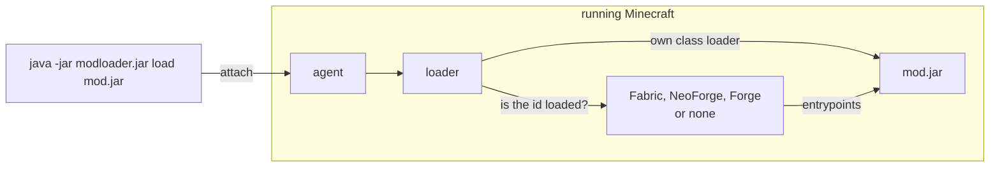

# ModLoader

Loads mods into a Minecraft that is already running, whether it runs Fabric, NeoForge, Forge or no mod framework
at all. `modloader.jar` is the command line tool, the agent it puts into the game and the loader inside it.

Minecraft 26.3 and later, Java 25.



## Use

Take `modloader.jar` from the [snapshot release](https://github.com/CCBlueX/ModLoader/releases/tag/snapshot) and run
it with a JDK, as the user the game runs as:

```sh
java -jar modloader.jar load mymod.jar another.jar
java -jar modloader.jar list
java -jar modloader.jar unload mymod
```

The game is found by its command line. `--pid <pid>` names it when several run, or when it was started as a plain
`server.jar`.

A mod loads once: when the game's framework or an earlier `load` already has its id, `load` says so and changes
nothing. Jars bundled in a mod load first, by the same rule.

## What runs

| In the mod | Runs in a game with |
|---|---|
| `RuntimeMod` from the API | any framework or none |
| Fabric `main`, `client` and `server` entrypoints | Fabric |
| NeoForge `@Mod` classes, `@EventBusSubscriber` classes, mod bus lifecycle events | NeoForge |
| Forge `@Mod` class, `@EventBusSubscriber` classes, mod bus lifecycle events | Forge |

A mod built for a framework the game lacks starts through its `RuntimeMod`; without one it is refused.

What a running game cannot take from a mod:

1. Anything the game freezes at startup, such as blocks, items and other registry content.
2. Mixins, access wideners and access transformers: they are not applied.
3. Assets and data: the jar is not added to the resource packs.

## API

A mod that implements `RuntimeMod` runs in every game and can be taken out again:

```java
public final class MyMod implements RuntimeMod {

    @Override
    public void load(LoadedMod mod) {
        // register listeners; keep `mod` and call mod.unload() to leave the game
    }

    @Override
    public void unload() {
        // remove them again
    }
}
```

List the class in `META-INF/services/net.ccbluex.modloader.api.RuntimeMod` and compile against
`modloader-api.jar` from the same release as `compileOnly`; the loader brings the classes. [example](example) has
an entrypoint for every framework.

`unload` closes the mod's class loader, so a rebuilt jar loads again without restarting the game. A mod that was
started only through framework entrypoints stays until the game exits.

## Build

```sh
./gradlew build   # cli/build/libs/modloader.jar
```

## Agent usage

Most of this code was written by AI models. Each declaration they wrote names its model in an `@agent` Javadoc tag.
These are all models used so far and what they cost, summed up by [agent-usage](https://github.com/1zun4/agent-usage):

<a href="https://ccbluex.github.io/ModLoader/ai-usage/">
  <picture>
    <source media="(prefers-color-scheme: dark)" srcset="https://ccbluex.github.io/ModLoader/ai-usage-dark.svg">
    
  </picture>
</a>

## Commits

`type(scope): subject`, lowercase, no trailing period.

`feat` `fix` `refactor` `chore` `docs` `test`

## License

This project is subject to the [GNU General Public License v3.0](https://www.gnu.org/licenses/gpl-3.0.en.html) (GPLv3). This only applies to source code located directly in this clean repository. During the development and compilation process, additional source code may be used to which we have obtained no rights. Such code is not covered by the GPL license.

For those who are unfamiliar with the license, here is a summary of its main points. This is by no means legal advice nor legally binding.

*Actions that you are allowed to do:*

* Use
* Share
* Modify

*If you do decide to use ANY code from the source:*

* **You must disclose the source code of your modified work and the source code you took from this project. This means you are not allowed to use code from this project (even partially) in a closed-source (or even obfuscated) application.**
* **Your modified application must also be licensed under the GPL.**
