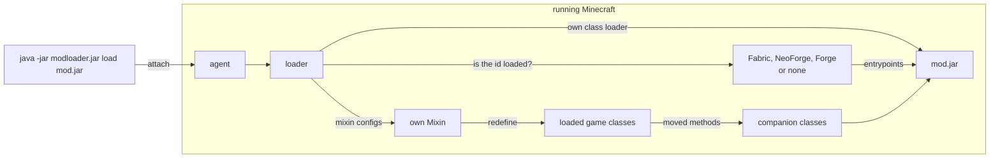

# ModLoader

Loads mods into a Minecraft that is already running, whether it runs Fabric, NeoForge, Forge or no mod framework
at all, and applies their mixins to the classes the game has long loaded. `modloader.jar` is the command line tool,
the agent it puts into the game and the loader inside it.

Minecraft 26.3 and later, Java 25.



## Use

Take `modloader.jar` from the [snapshot release](https://github.com/CCBlueX/ModLoader/releases/tag/snapshot) and run
it with a JDK, as the user the game runs as:

```sh
java -jar modloader.jar load mymod.jar another.jar
java -jar modloader.jar list
java -jar modloader.jar unload mymod
```

The game is found by its command line. `--pid <pid>` names it when several run, or when it was started as a plain
`server.jar`.

A mod loads once: when the game's framework or an earlier `load` already has its id, `load` says so and changes
nothing. Mods bundled in a jar load and unload together with it, unless the game already has them.

## What runs

| In the mod | Runs in a game with |
|---|---|
| Mixins, and code compiled against an access widener or transformer | any framework or none |
| `RuntimeMod` from the API | any framework or none |
| Fabric `main`, `client` and `server` entrypoints, and the others for the mods that ask for them; the mod is in Fabric Loader's mod list, and libraries of the game find its classes and services | Fabric |
| NeoForge `@Mod` classes, `@EventBusSubscriber` classes, mod bus lifecycle events | NeoForge |
| Forge `@Mod` class, `@EventBusSubscriber` classes, mod bus lifecycle events | Forge |

A mod built for a framework the game lacks runs its mixins and its `RuntimeMod`; with neither it is refused.

## Mixins

The JVM lets a loaded class change what its methods do and nothing else: no new method, field or interface. So
ModLoader runs a Mixin of its own over the class as the game defined it, keeps the class's shape, and moves the rest
into a class beside it: handler methods, added methods and the new bodies of changed methods. The loaded class only
calls over. Added fields live outside the object, and code that reads a non-public member through an access widener
reaches it the same way. Mixins the game's own Mixin applied to the same class, such as Fabric API's, run again
together with the mod's, as they would have at startup. Unloading the mod puts the classes back as they were.

What a running game cannot take from a mod:

1. Anything tied to the game's start: registry content such as blocks and items, and what a mod only sets up in an
   event of the start, such as its commands when the server starts.
2. Assets and data: the jar is not added to the resource packs.
3. A field a mixin adds gets its initializer on the first read on objects that existed before, when the initializer
   reads nothing but the object; otherwise it starts at zero or null there.
4. A mixin that overrides a method its target only inherits, or changes a constructor before the `super(...)` call:
   the mod is refused with the reason. A change inside a static initializer has nothing left to change; it is left
   out and `load` says so.
5. An interface a mixin adds is seen by the code of the loaded mods, not by the game: the game's own `instanceof`
   stays false. In the same way an access widener cannot make a class extendable.

## API

A mod that implements `RuntimeMod` runs in every game and can be taken out again:

```java
public final class MyMod implements RuntimeMod {

    @Override
    public void load(LoadedMod mod) {
        // register listeners; keep `mod` and call mod.unload() to leave the game
    }

    @Override
    public void unload() {
        // remove them again
    }
}
```

List the class in `META-INF/services/net.ccbluex.modloader.api.RuntimeMod` and compile against the API as
`compileOnly`; the loader brings the classes. [example](example) has an entrypoint for every framework and a mixin.

```kotlin
repositories {
    maven("https://maven.ccbluex.net/snapshots")
}

dependencies {
    compileOnly("net.ccbluex:modloader-api:0.1.0-SNAPSHOT")
}
```

`unload` takes the mod's mixins out of the game and closes its class loader, so a rebuilt jar loads again without
restarting the game. A mod that was started through framework entrypoints and has no `RuntimeMod` stays until the
game exits: what it registered there cannot be taken back.

## Build

```sh
./gradlew build   # cli/build/libs/modloader.jar
```

## Agent usage

Most of this code was written by AI models. Each declaration they wrote names its model in an `@agent` Javadoc tag.
These are all models used so far and what they cost, summed up by [agent-usage](https://github.com/1zun4/agent-usage):

<a href="https://ccbluex.github.io/ModLoader/ai-usage/">
  <picture>
    <source media="(prefers-color-scheme: dark)" srcset="https://ccbluex.github.io/ModLoader/ai-usage-dark.svg">
    
  </picture>
</a>

## Commits

`type(scope): subject`, lowercase, no trailing period.

`feat` `fix` `refactor` `chore` `docs` `test`

## License

This project is subject to the [GNU General Public License v3.0](https://www.gnu.org/licenses/gpl-3.0.en.html) (GPLv3). This only applies to source code located directly in this clean repository. During the development and compilation process, additional source code may be used to which we have obtained no rights. Such code is not covered by the GPL license.

For those who are unfamiliar with the license, here is a summary of its main points. This is by no means legal advice nor legally binding.

*Actions that you are allowed to do:*

* Use
* Share
* Modify

*If you do decide to use ANY code from the source:*

* **You must disclose the source code of your modified work and the source code you took from this project. This means you are not allowed to use code from this project (even partially) in a closed-source (or even obfuscated) application.**
* **Your modified application must also be licensed under the GPL.**
